

  

  

  

Programa científico · Perú · 2018–2026

<h1>Medimos el hielo que queda.</h1>

Altimetría satelital, radar, estaciones meteorológicas y muestreo de carbono negro para observar cómo cambian los glaciares tropicales del Perú —y separar lo demostrado de lo que aún está en evaluación.

<a class="ma-btn ma-btn--primary" href="investigacion/cambio-elevacion.html">Ver el resultado principal →</a>
<a class="ma-btn ma-btn--ghost" href="datos/index.html">Explorar datos</a>

  

  
↓

  

113muestras de nieve y hielo inventariadas en 2026

68adquisiciones Sentinel‑1 auditadas en Vilcanota

129pasadas ICESat‑2 en la serie regional revisada

−1.463m año⁻¹ · descenso regional ponderado por hipsometría

  

Resultado central

## Un descenso regional robusto en Vilcanota

La serie ICESat‑2 ATL06‑SR de diciembre de 2018 a febrero de 2026 converge en una pérdida superficial cercana a **1.5 m por año**. La estimación ponderada por área hipsométrica es **−1.463 m año⁻¹** (IC95%: −2.357 a −0.596) y representa 96.5% del área analizada. La señal es más negativa en cotas bajas y medias-bajas, aproximadamente entre 5 000 y 5 400 m.

<figure class="ma-science-figure" data-reveal>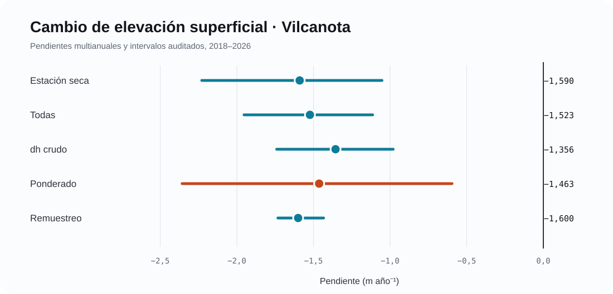<figcaption>Cinco estimadores independientes convergen en signo y magnitud. El remuestreo hipsométrico reporta percentiles 5–95, no un intervalo de confianza convencional.</figcaption></figure>

<strong>Incertidumbre que permanece.</strong> El sesgo central del terreno estable quedó casi nulo tras el co‑registro, pero el NMAD residual permanece alto (~4.63 m). El resultado multianual es sólido; la incertidumbre puntual y la máscara estable aún requieren pruebas de sensibilidad.

Sistema de evidencia

## Una cadena multifuente, no una sola imagen

Cada instrumento observa una parte distinta del sistema. MeteoAndes conserva esas diferencias físicas para evitar equivalencias incorrectas entre desplazamiento radar, cambio de elevación, concentración atmosférica y deposición.

  

Atmósfera
<strong>AL30 · AE33 · Sentinel‑5P</strong>
Exposición y transporte de aerosoles.

  

Meteorología
<strong>AWS · ERA5 · CHIRPS</strong>
Temperatura, precipitación, nubosidad y viento.

  

Depósito
<strong>SP2 · iones · capas</strong>
rBC y composición química en nieve/hielo.

  

Energía
<strong>Albedo · SW/LW · Rn</strong>
Absorción radiativa y fusión potencial.

  

Respuesta
<strong>ICESat‑2 · InSAR</strong>
Cambio de elevación y movimiento coherente.

Estado científico

## Lo consolidado, lo preliminar y lo pendiente

MeteoAndes muestra el nivel de madurez de cada afirmación. Una arquitectura completa no equivale automáticamente a una conclusión causal.

  
Consolidado<strong>ICESat‑2 Vilcanota</strong>
Descenso regional multianual, estimadores robustos y diagnóstico hipsométrico.

  
Diagnóstico<strong>InSAR Vilcanota</strong>
Geometría bien condicionada; señal mensual cercana al piso de ruido; acumulado final pendiente.

  
Preliminar<strong>Carbono negro</strong>
Variabilidad AL30 y perfiles SP2/iones; falta cerrar QA/QC y sincronización temporal.

  
Pendiente<strong>Atribución a incendios</strong>
Sentinel‑5P y catálogo de eventos aún no producen evidencia causal final.

Sitios y campañas

## Cinco unidades de estudio, tres cordilleras

La red combina el campo de hielo regional de Vilcanota y cuatro sitios de campaña criogeoquímica. Las tarjetas distinguen resultados regionales de mediciones de sesión.

<a class="ma-card" href="glaciares/vilcanota.html" data-reveal>
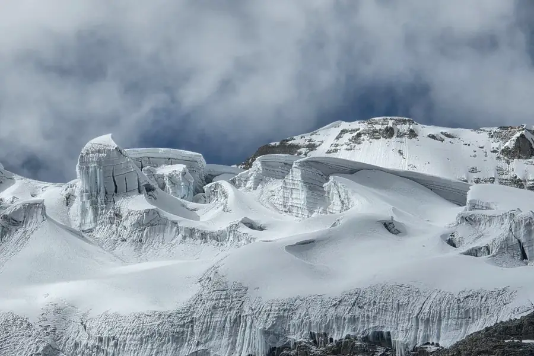

Cordillera Vilcanota
<h3>Campo de hielo regional</h3>
Resultado ICESat‑2 consolidado e InSAR diagnóstico.

2018–2026 · 254.01 km² efectivos

</a>
<a class="ma-card" href="glaciares/quelccaya.html" data-reveal data-reveal-delay="80">
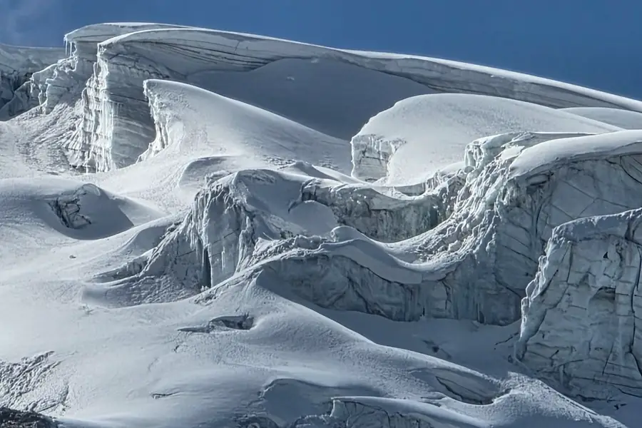

Cusco · Vilcanota
<h3>Quelccaya</h3>
Meteorología, AL30 y 48 muestras de nieve/hielo.

5 200–5 680 m · campaña 2026

</a>
<a class="ma-card" href="glaciares/huaytapallana.html" data-reveal data-reveal-delay="160">
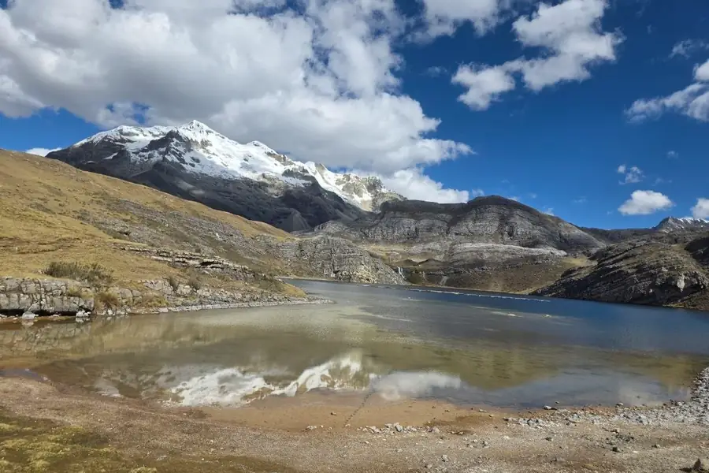

Junín · Huaytapallana
<h3>Huaytapallana / Cochas</h3>
AL30 de campaña, AE33 2022–2024 y 25 muestras.

eBC preliminar · dos jornadas

</a>
<a class="ma-card" href="glaciares/tunshu.html" data-reveal>
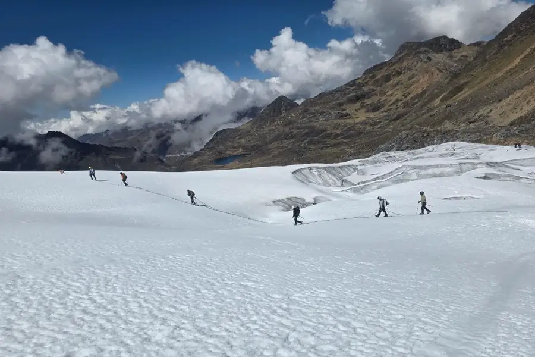

Junín · Andes centrales
<h3>Tunshu</h3>
Campaña AL30 y 21 muestras para SP2, iones e isótopos.

</a>
<a class="ma-card" href="glaciares/mateo.html" data-reveal data-reveal-delay="80">
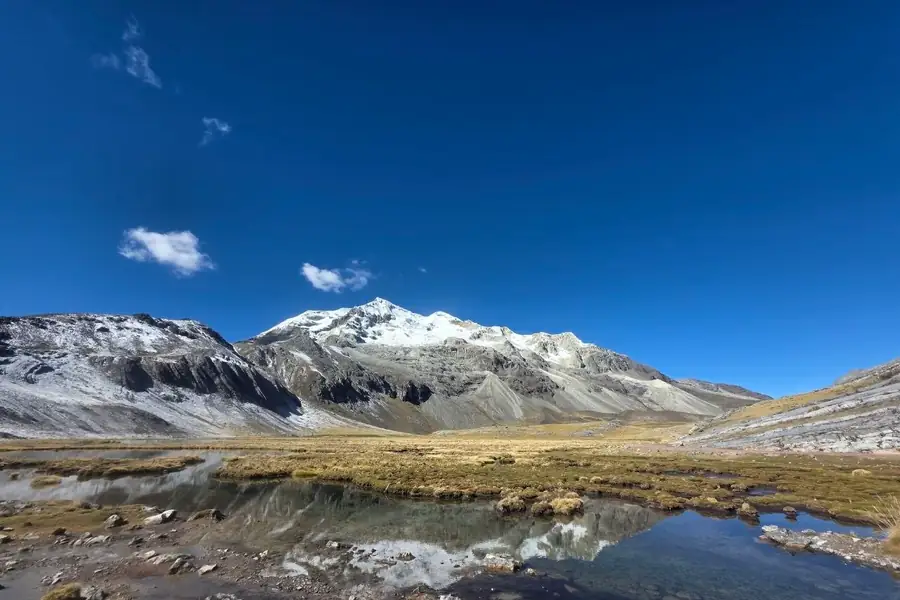

Áncash · Cordillera Blanca
<h3>Mateo / Contrayerba</h3>
Gradiente altitudinal AL30 y perfil de 19 muestras entre 0–95 cm.

</a>
<a class="ma-card" href="datos/index.html" data-reveal data-reveal-delay="160">
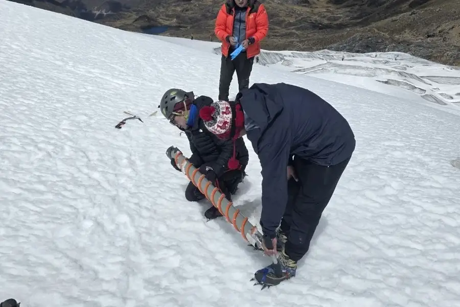

Ciencia abierta
<h3>Catálogo de datos</h3>
Tablas ligeras, estado de evidencia y metadatos de reutilización.

</a>

Campañas de campo

## Mediciones a 5 000 metros

Cada cifra de este sitio proviene de expediciones con instrumentos portátiles, testigos de nieve y estaciones instaladas sobre el hielo. Una selección del trabajo de campo 2024–2026 en Vilcanota, Junín y Áncash.

<figure>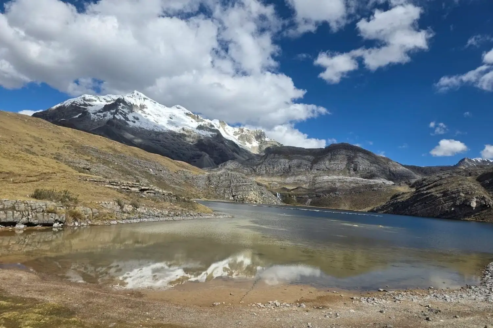<figcaption>Laguna altoandina · Puna</figcaption></figure>
<figure>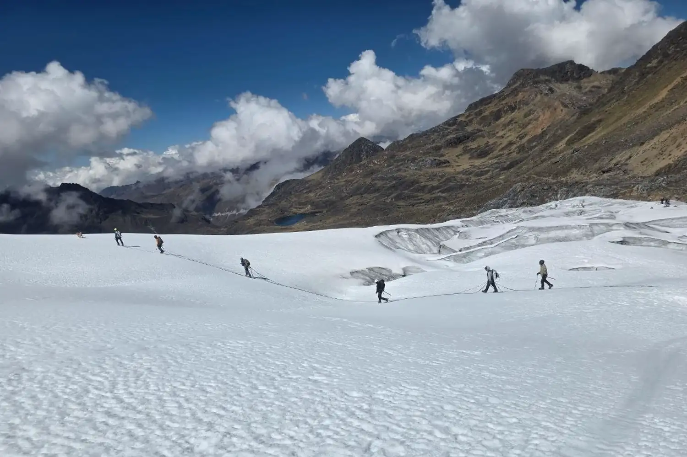<figcaption>Travesía sobre el campo de hielo</figcaption></figure>
<figure>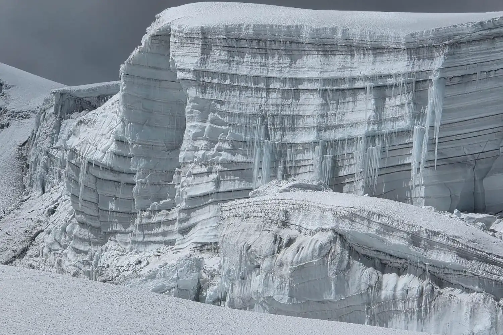<figcaption>Estratigrafía del hielo</figcaption></figure>
<figure>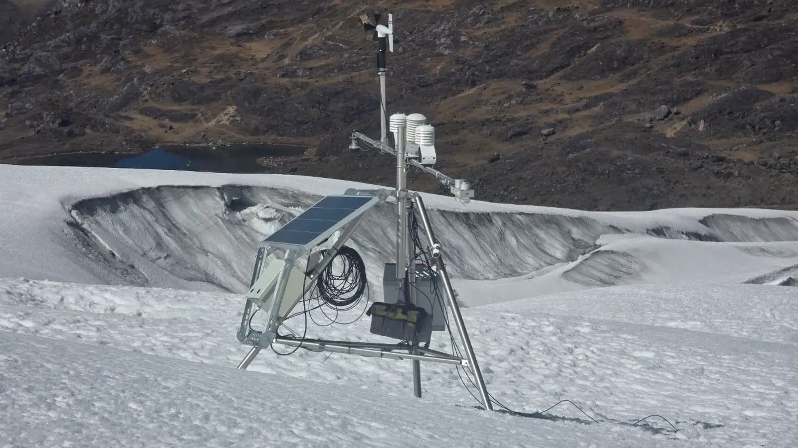<figcaption>Estación meteorológica en el glaciar</figcaption></figure>
<figure>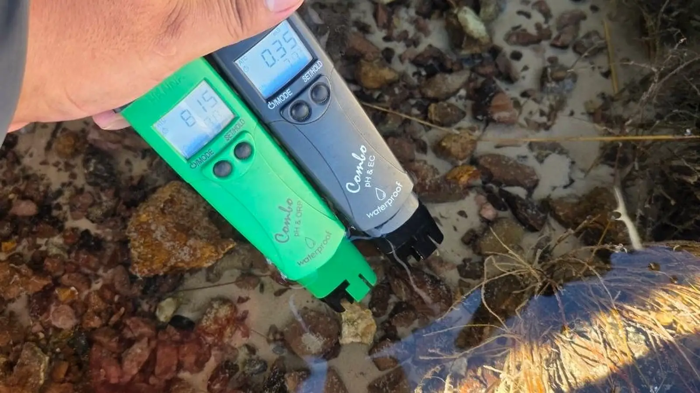<figcaption>Agua de deshielo · sonda multiparamétrica</figcaption></figure>
<figure>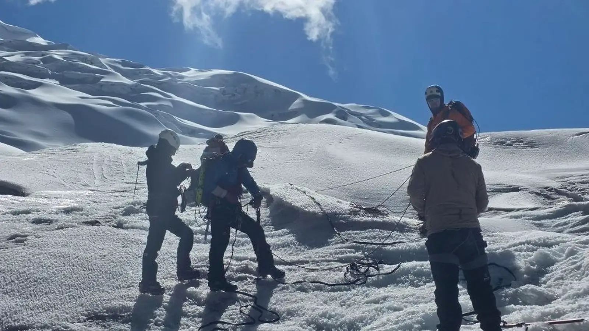<figcaption>Equipo de campaña · Vilcanota</figcaption></figure>

Albedo

## Del hielo brillante a una superficie más absorbente

El comparador ilustra el mecanismo físico —no una observación cuantitativa de una campaña específica—: una reducción del albedo aumenta la radiación de onda corta neta absorbida. Bajo 600 W m⁻², una reducción instantánea de 0.05 implicaría aproximadamente 30 W m⁻² adicionales de absorción, antes de considerar nubosidad, temperatura superficial y flujos turbulentos.

  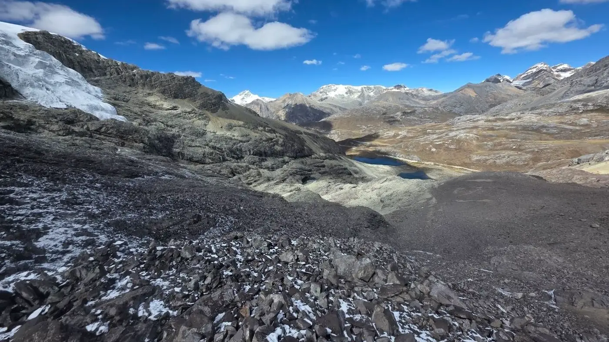
  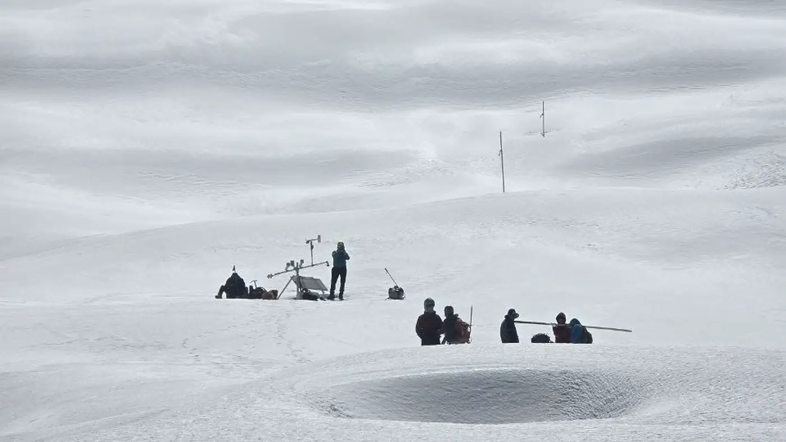
  superficie limpiasuperficie oscurecida
  

<button class="ma-albedo__knob" role="slider" aria-label="Posición del comparador de albedo" aria-valuemin="0" aria-valuemax="100" aria-valuenow="50">↔</button>

Transparencia

## La afirmación causal todavía no está cerrada

El descenso glaciar observado no puede atribuirse todavía a incendios forestales específicos. Faltan una serie Sentinel‑5P validada, un catálogo de eventos, ventanas antes–durante–después, trayectorias, controles meteorológicos y sincronización con eBC/rBC, albedo y respuesta geométrica.

<strong>Regla editorial.</strong> MeteoAndes no presenta dU mensual de InSAR como balance de masa, eBC atmosférico como deposición, una anomalía anual positiva como recuperación estructural, ni un trazador químico aislado como prueba inequívoca de fuente.

